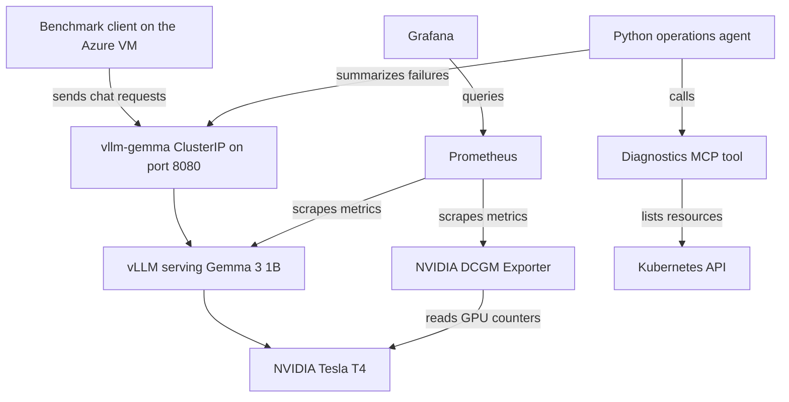

# vLLM on Azure K3s

I built this lab to serve Gemma 3 1B on one NVIDIA Tesla T4 and see what happens when several requests arrive at once. I also used the same model to explain Kubernetes pod failures through a read-only diagnostics tool.

## How it works



The lab ran on an Azure `Standard_NC4as_T4_v3` VM with Ubuntu 24.04 LTS, K3s `v1.37.2+k3s1`, and 16 GiB of GPU memory. The chart runs vLLM `0.11.0` in FP32 with a 2,048-token context, eager execution, and PyTorch sampling. The Triton patch reduces the FP32 prefill tile to fit the T4's shared-memory limit. [Helm chart](charts/vllm-t4)

## Run inference

Use an existing Azure K3s lab with the NVIDIA driver, Container Toolkit, and device plugin configured. The chart needs the `nvidia` RuntimeClass and one allocatable `nvidia.com/gpu`. It requests 2 CPUs, 10 GiB of RAM, and 10 GiB of ephemeral storage. Allow disk space for the container image and model weights.

The chart expects the `vllm-example` namespace and a Kubernetes Secret named `hf-secret`. Its `hf_token` key holds a token for a Hugging Face account with access to `google/gemma-3-1b-it`.

For a fresh vLLM installation with a free GPU, run Helm 4.3.2 from the repository root on the Azure VM.

```bash
sudo helm upgrade --install vllm-t4 charts/vllm-t4 \
  --kubeconfig /etc/rancher/k3s/k3s.yaml --namespace vllm-example
```

Check the rollout and forward the internal Service to the Azure VM's loopback interface. Leave the forward running for the smoke test.

```bash
sudo k3s kubectl -n vllm-example rollout status deployment/vllm-gemma-deployment --timeout=10m
sudo k3s kubectl -n vllm-example port-forward svc/vllm-gemma 8080:8080
```

From a second shell on the VM, wait for `/health` to return HTTP 200, then ask the model a simple question.

```bash
curl -fsS http://127.0.0.1:8080/health
curl -fsS http://127.0.0.1:8080/v1/chat/completions \
  --json '{"model":"google/gemma-3-1b-it","messages":[{"role":"user","content":"What is 2 + 2? Reply with just the number."}],"temperature":0,"max_tokens":16}'
```

In the lab, the chat request returned HTTP 200 and `choices[0].message.content` contained `4`.

## Observe the service and GPU

Prometheus collected vLLM metrics every 15 seconds and GPU metrics from NVIDIA DCGM Exporter every five seconds. With Prometheus and DCGM Exporter deployed in `vllm-example`, add these jobs to `scrape_configs`.

```yaml
scrape_configs:
  - job_name: vllm
    scrape_interval: 15s
    static_configs:
      - targets: ["vllm-gemma:8080"]
  - job_name: dcgm-exporter
    scrape_interval: 5s
    static_configs:
      - targets: ["dcgm-exporter:9400"]
```

Point Grafana's Prometheus data source at the lab's Prometheus Service and use the data source UID `prometheus`. Import the dashboard to see request counts, output rate, the queue, p95 latency, GPU utilization, and GPU framebuffer memory. The lab verified both scrape jobs with `up = 1`. [Grafana dashboard](monitoring/vllm-inference-dashboard-milestone-1.json)

## What the load test showed

| Measurement | One request at a time | Up to four in flight |
| --- | ---: | ---: |
| Completed requests | 5/5 | 60/60 |
| Median time to first text | 48.3 ms | 73.3 ms |
| Median end-to-end latency | 1.843 s | 1.675 s |
| Aggregate output rate | 23.9 tokens/s | 105.0 tokens/s |

The four-worker run had a p95 end-to-end latency of 1.681 seconds. In a separate 60-request GPU sampling run, `nvidia-smi` showed 45.3% mean utilization and a 52% peak across 24 samples. Used framebuffer memory held near 13.5 GiB.

The Python client ran on the VM and streamed replies through the internal Service. It reused the prompt “Explain what a Kubernetes Service does in about 40 words.” with temperature 0 and a 64-token output cap. A prior request reported 22 prompt tokens, and sampled replies contained 44 output tokens. The sequential run used one warm-up and five measured requests totaling about 9.22 seconds. The concurrent run submitted 60 requests to a four-worker thread pool. First-text time ends at the first chunk with generated text, and concurrent output rate divides all completion tokens by batch wall-clock time.

To repeat the runs, restore the separately saved `vllm_stream_benchmark.py` to the VM's home directory. Run the sequential benchmark, then use its `stream_request` function for the four-worker run.

```bash
vllm_ip="$(sudo k3s kubectl -n vllm-example get svc vllm-gemma -o jsonpath='{.spec.clusterIP}')"
vllm_url="http://${vllm_ip}:8080"
python3 "$HOME/vllm_stream_benchmark.py" "$vllm_url"

PYTHONPATH="$HOME" python3 - "$vllm_url" <<'PY'
import sys
from concurrent.futures import ThreadPoolExecutor
from math import ceil
from statistics import median
from time import perf_counter

from vllm_stream_benchmark import stream_request

request_count = 60
with ThreadPoolExecutor(max_workers=4) as workers:
    started_at = perf_counter()
    results = list(workers.map(stream_request, [sys.argv[1]] * request_count))
    elapsed = perf_counter() - started_at

latencies = sorted(duration for _, duration, _ in results)
output_tokens = sum(tokens for _, _, tokens in results)
print(f"Completed {len(results)}/{request_count} requests in {elapsed:.2f} s")
print(f"Generated {output_tokens} tokens in total")
print(f"Median time to first text {1000 * median(row[0] for row in results):.1f} ms")
print(f"Median latency {median(latencies):.3f} s")
print(f"p95 latency {latencies[ceil(0.95 * len(latencies)) - 1]:.3f} s")
print(f"Aggregate output rate {output_tokens / elapsed:.1f} tokens/s")
PY
```

## Run the diagnostics demo

Restore the `.whl` files from the separate `vllm-diagnostics-milestone-2-wheelhouse.tar.gz` backup into `/home/azureuser/vllm-diagnostics/wheelhouse` on the GPU VM. The pod installs `mcp==1.29.0` and its dependencies from that directory at startup. The files must be readable by the container's UID 10001.

```bash
sudo k3s kubectl -n vllm-example apply -f diagnostics/vllm-diagnostics-milestone-2.json
sudo k3s kubectl -n vllm-example rollout status deployment/vllm-diagnostics-mcp --timeout=120s
sudo k3s kubectl -n vllm-example exec deployment/vllm-diagnostics-mcp -- \
  /tmp/mcp-venv/bin/python -B /opt/diagnostics/vllm_ops_agent.py
```

The agent calls the MCP tool `get_vllm_health`. Its ServiceAccount can list deployments, replica sets, pods, and events in `vllm-example`. The agent prints the current deployment status and asks Gemma to summarize past failures. In the demo it found an available vLLM deployment, two earlier pod evictions from low ephemeral storage, and a GPU allocation failure. Gemma suggested checks for the operator to run. [Diagnostics manifest](diagnostics/vllm-diagnostics-milestone-2.json)

## Validate a change

Run these checks from the repository root with Helm 4.3.2 and PowerShell 7.

```bash
helm lint charts/vllm-t4 --namespace vllm-example
helm template vllm-t4 charts/vllm-t4 --namespace vllm-example
pwsh -File ./scripts/Test-Diagnostics.ps1
```

GitHub Actions runs the same checks on pushes to `main` and on pull requests targeting it. The PowerShell check verifies that the Deployment uses the expected ServiceAccount and that its RoleBinding grants the four list permissions above. The first run passed on a clean Ubuntu runner. [GitHub Actions run](https://github.com/KiranItagi666/vllm-azure-k3s-lab/actions/runs/44926997689)
